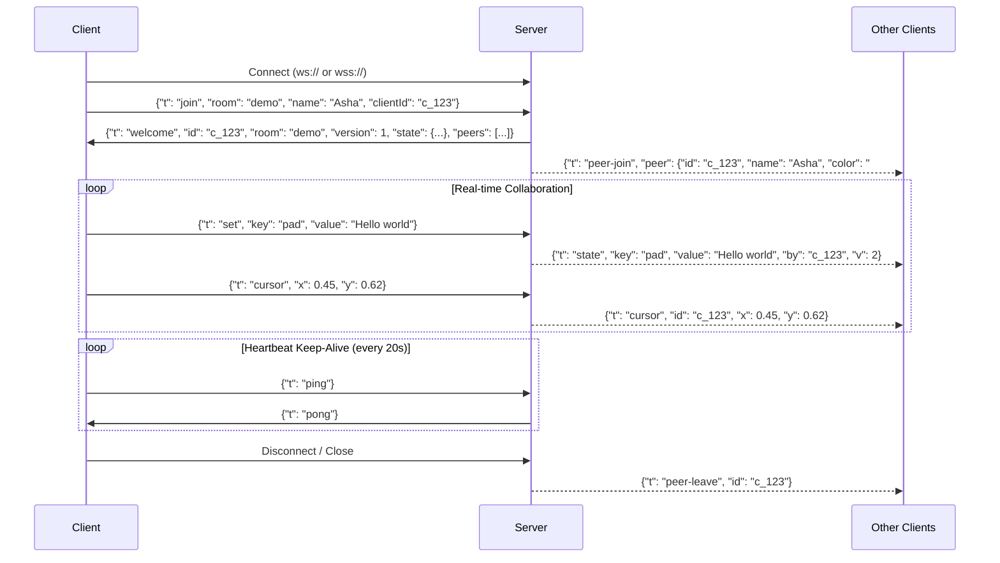

# SyncSpace WebSocket Protocol Specification

SyncSpace uses a JSON-based real-time protocol over standard WebSockets. All frames are UTF-8 encoded JSON text frames.

---

## 1. Connection Lifecycle

---

## 2. Client-to-Server Messages

Every message sent by the client must have a type field `"t"`.

| Message Type (`t`) | Required Fields | Optional Fields | Description |
|---|---|---|---|
| `join` | `room` (string, 1-32 chars) | `name` (string, max 24), `clientId` (string) | Sent immediately after socket opens. `clientId` is preserved across reconnects. |
| `set` | `key` (string, 1-64 chars) | `value` (JSON serializable, max 10KB) | Set or update a shared key. Omit `value` to delete key. |
| `cursor` | `x` (number, 0.0-1.0), `y` (number, 0.0-1.0) | - | Send normalized viewport mouse coordinates (~30fps max). |
| `ping` | - | - | Heartbeat frame to ensure socket remains open through proxies. |
| `doc-op` | `rev` (number), `op` (array), `opId` (string) | `resend` (boolean) | One notepad edit. `rev` is the notepad revision the edit was made on. `op` is a list: positive number = keep characters, negative number = delete characters, string = insert text. The server merges it with edits made by others at the same time. `resend: true` is used after a reconnect. |
| `doc-sync` | - | - | Ask the server for a fresh copy of the notepad (`doc-resync`). |
| `counter` | `action` (`inc`, `dec` or `reset`) | - | Change the shared counter. The server does the math, so clicks from several people at once all count. |

---

## 3. Server-to-Client Messages

| Message Type (`t`) | Fields | Description |
|---|---|---|
| `welcome` | `id`, `room`, `version`, `state`, `peers`, `doc`, `docOps`, `docHistory`, `counter` | Confirmation of join. Contains full shared state snapshot and online peer list. `doc` is `{ text, rev }`. `docOps` (optional, only on reconnect) lists the notepad edits the client missed. `docHistory` is the list of notepad edits (who, when, what). `counter` is `{ value, history }`. |
| `doc-op` | `rev`, `op`, `by`, `name`, `opId`, `entry` | Another person edited the notepad. `entry` is the (new or updated) history line for that edit. |
| `doc-ack` | `rev`, `opId`, `entry` | Your own notepad edit was accepted and given revision `rev`. |
| `doc-resync` | `text`, `rev` | Your notepad copy was out of step: replace it with this text. |
| `counter` | `value`, `entry` | The counter changed. `entry` is `{ user, userId, color, ts, action, delta, before, value }`. Sent to everyone, including the person who clicked. |
| `state` | `key`, `value`, `by`, `v` | Broadcast when any peer updates a key. `by` contains peer ID; `v` is the room version. |
| `peer-join` | `peer: { id, name, color }` | Broadcast when a new peer enters the room. |
| `peer-leave` | `id` | Broadcast when a peer disconnects or times out. |
| `cursor` | `id`, `x`, `y` | Broadcast peer cursor coordinates (sent to other peers in room only). |
| `pong` | - | Server heartbeat reply. |
| `error` | `code`, `message` | Returned on invalid requests without crashing the server. |

---

## 4. Error Codes

| Code | Description |
|---|---|
| `bad_json` | Inbound payload could not be parsed as JSON. |
| `bad_message` | Inbound object is missing required `"t"` type property. |
| `bad_room` | Room name does not match `^[A-Za-z0-9_-]{1,32}$`. |
| `not_joined` | Attempted to mutate state or send cursor before joining a room. |
| `already_joined` | Attempted to send a second `join` message on an existing connection. |
| `room_full` | Room has reached maximum allowed concurrent peers (25). |
| `bad_key` | Key string is empty or exceeds 64 characters. |
| `too_big` | Payload value exceeds 10,000 serialized JSON characters. |
| `too_many_keys` | Room has reached maximum stored keys (100). |
| `rate_limited` | Exceeded rate limits (30 updates/sec for state, 60 updates/sec for cursor). |
| `unknown_type` | Unrecognized message type. |

---

## 5. Security & Resource Limits

- **Room Isolation**: Each room maintains independent key-value state and peer lists. Data never leaks across rooms.
- **Max Payload Size**: 16 KB per WebSocket frame.
- **Empty Room TTL**: Empty rooms are garbage collected after 10 minutes of inactivity.
- **Heartbeat & Dead Peer Detection**: Ping sweep every 30 seconds terminates unacknowledged sockets.

---

## 4. Notepad merging, history and saving

- **Merging:** the notepad is not sent as one big text. Each edit is a small `doc-op`. If two people edit at the same time, the server shifts (transforms) the later edit so that both survive, and every screen ends up with the same text. The shared logic lives in `web/ot.js`.
- **History:** every notepad edit is recorded with the user's name and time. Typing by the same person within 8 seconds is shown as one line. The last 200 lines are kept per room. The counter keeps the last 100 changes with the name of who pressed which button.
- **Saving:** when the server is started with `npm start`, room data (notepad text, both histories, counter, shared keys) is saved to `data/rooms.json` after changes, and loaded again at startup. Set the `DATA_FILE` environment variable to use a different file. Note: on Render's free plan the disk is erased on every restart or redeploy, so the saved file only survives restarts on a computer or on a Render plan with a persistent disk.
