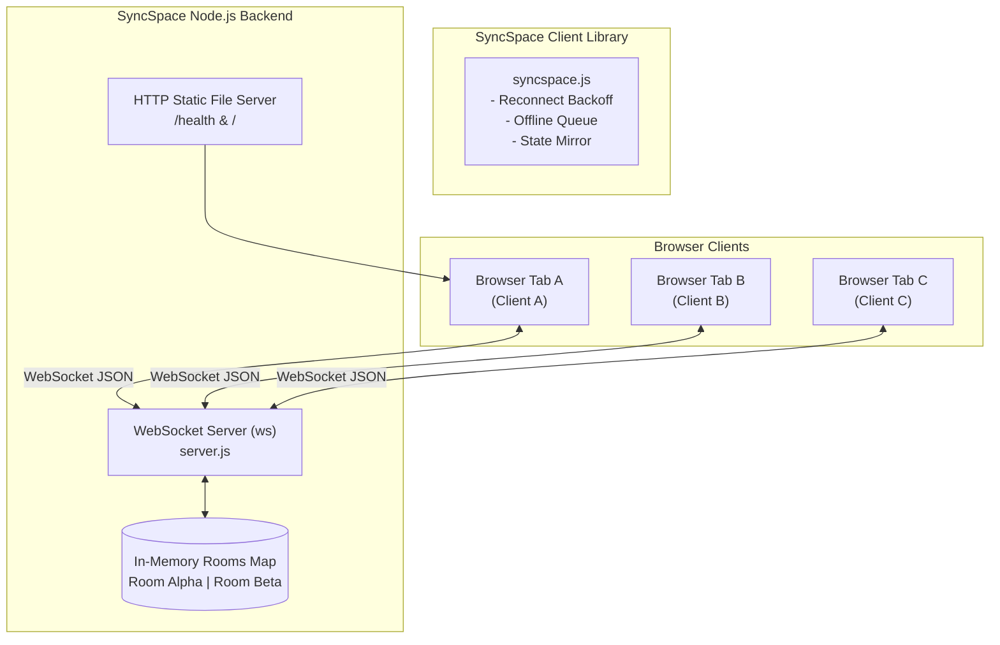

# ⚡ SyncSpace — Multiplayer in 10 Lines

> **PS1 — Hackathon Project**  
> A lightweight, dependency-free real-time coordination library that adds shared state, live cursors, and online presence to any webpage in under 10 lines of vanilla JavaScript.

[](LICENSE)
[](https://nodejs.org)
[](https://github.com/websockets/ws)
[](test/test.js)

---

## 🚀 Live Demo & Deployments

- **Frontend (GitHub Pages):** [https://gouravsharmaswe-ship-it.github.io/hackodec.jaadugar/](https://gouravsharmaswe-ship-it.github.io/hackodec.jaadugar/)
- **Backend Service (Render):** `https://syncspace-backend.onrender.com` / `wss://syncspace-backend.onrender.com`
- **Full-Stack Localhost:** `http://localhost:3000`

---

## ⚡ Multiplayer in 10 Lines (Integration Example)

Drop `syncspace.js` into your webpage and add real-time multiplayer functionality with minimal code:

```html
<script src="syncspace.js"></script>
<script>
  // 1. Connect to any room with your name
  const room = SyncSpace.connect({ url: 'wss://YOUR-BACKEND', room: 'hackathon', name: 'Asha' });

  // 2. Listen to shared state changes from any peer
  room.on('state', (key, val) => console.log(`State update: ${key} =`, val));

  // 3. Mutate shared state (broadcasts to all peers in room)
  room.set('score', 42);

  // 4. Online presence list
  room.on('presence', peers => console.log('Peers online:', peers.map(p => p.name)));

  // 5. Live smooth cursors (normalized coordinates 0.0 to 1.0)
  document.onmousemove = e => room.cursor(e.clientX / innerWidth, e.clientY / innerHeight);
  room.on('cursor', (id, x, y, peer) => renderCursor(id, x, y, peer));
</script>
```

---

## 🏗️ Architecture



---

## ✨ Mandatory Features Implemented

1. **Reusable Client Library (`syncspace.js`):** Contained in a single standalone file, zero npm/vendor dependencies, UMD compatible.
2. **Real-Time Backend Server (`server.js`):** Lightweight Node.js server powered by `ws` with static file serving and `/health` status endpoint.
3. **Shareable Room Links:** Deep linking via `?room=YOUR_ROOM` with automatic room code generation and 1-click clipboard copy.
4. **Shared-State Synchronization:** Real-time key-value mutations across 3+ tabs simultaneously (collaborative notepad, counter, room accent, shared ideas).
5. **Live Cursors:** High-performance, normalized 60fps cursor streaming displaying peer name tags and custom colors.
6. **Online Presence List:** Dynamic roster showing active peer count, avatars, initials, and `(YOU)` identifier.
7. **Automatic Reconnection & State Recovery:** Network drop detection, exponential backoff with jitter, offline mutation queue flush, and full server state snapshot restoration.
8. **Polished Demo Webpage:** Modern dark-mode glassmorphic UI styled with Google Fonts (`Plus Jakarta Sans`), subtle ambient glow, and micro-animations using only the library's public API.
9. **Automated Testing Suite:** 7 automated end-to-end integration tests using a controllable TCP proxy to simulate real network severance.
10. **Dual Deployment Configuration:** Works as a standalone single-container service on Render or as an independent static frontend on GitHub Pages.

---

## 💻 Quickstart (Run Locally)

### Prerequisites
- Node.js 18+ installed

### Steps

```bash
# 1. Clone repository
git clone https://github.com/gouravsharmaswe-ship-it/hackodec.jaadugar.git
cd hackodec.jaadugar/syncspace

# 2. Install dependencies
npm install

# 3. Run automated tests
npm test

# 4. Start the server
npm start
```

Open `http://localhost:3000` in **three different browser tabs** (or share your local IP with your teammates on the same Wi-Fi).

---

## 🧪 Automated Integration Tests

Run the test suite with:

```bash
npm test
```

### Test Evidence (7/7 Passing)

```
========================================
🧪 Starting SyncSpace Integration Tests
========================================

  ✓ PASS: Online presence list accurately tracks all 3 connected clients in room
  ✓ PASS: Shared-state synchronization propagates across all 3 browser tabs
  ✓ PASS: Different rooms remain strictly isolated (zero state or presence leak)
  ✓ PASS: Live cursor movements broadcast exclusively to peers in the same room
  ✓ PASS: A new peer joining late receives the full latest shared state snapshot
  ✓ PASS: Client and server reject malformed inputs and handle errors gracefully
  ✓ PASS: Genuine temporary network severance -> auto-reconnect -> offline writes synced

========================================
Test Results: 7 passed, 0 failed
========================================
```

---

## 🌐 Deployment Instructions

### Option 1: Render (Full-Stack All-in-One — Recommended)

Render supports persistent WebSocket connections on its free tier:

1. Log in to [Render.com](https://render.com).
2. Click **New +** → **Blueprint** or **Web Service**.
3. Select your GitHub repository: `gouravsharmaswe-ship-it/hackodec.jaadugar`.
4. Render automatically detects `render.yaml`:
   - **Build Command:** `npm install`
   - **Start Command:** `npm start`
   - **Health Check Path:** `/health`
5. Click **Create Web Service**. Render provisions:
   - Public HTTPS & WSS URL: `https://syncspace-backend.onrender.com`

### Option 2: GitHub Pages (Static Frontend)

The frontend is already configured in `/docs` and enabled on GitHub Pages:
- **URL:** [https://gouravsharmaswe-ship-it.github.io/hackodec.jaadugar/](https://gouravsharmaswe-ship-it.github.io/hackodec.jaadugar/)
- Connects automatically to the deployed backend or allows custom backend overrides via `?server=wss://...`.

---

## ⚠️ Free-Tier Hosting Limitations & Trade-offs

| Service | Limitation | Trade-off / Mitigation |
|---|---|---|
| **Render (Free Web Service)** | Spins down after 15 minutes of inactivity | First request takes ~30-50s to wake up (cold start). Once awake, WebSockets run at full speed. |
| **In-Memory Room State** | State is held in Node.js server memory | Server restart or sleep clears existing rooms. Suitable for hackathon demos; for persistent production, back with Redis or SQLite. |
| **GitHub Pages** | Static hosting only (no backend process) | Configured to connect to external WebSocket endpoint via `config.js` or `?server=` parameter. |

---

## 📜 Message Protocol

Full documentation of the WebSocket JSON frames, payload limits, rate-limiting, and error codes is in [PROTOCOL.md](PROTOCOL.md).

---

## 👥 Hackathon Team

- **Project:** SyncSpace (PS1 — Multiplayer in 10 lines)
- **Institution:** IIIT Kota
- **Repository:** [https://github.com/gouravsharmaswe-ship-it/hackodec.jaadugar](https://github.com/gouravsharmaswe-ship-it/hackodec.jaadugar)
